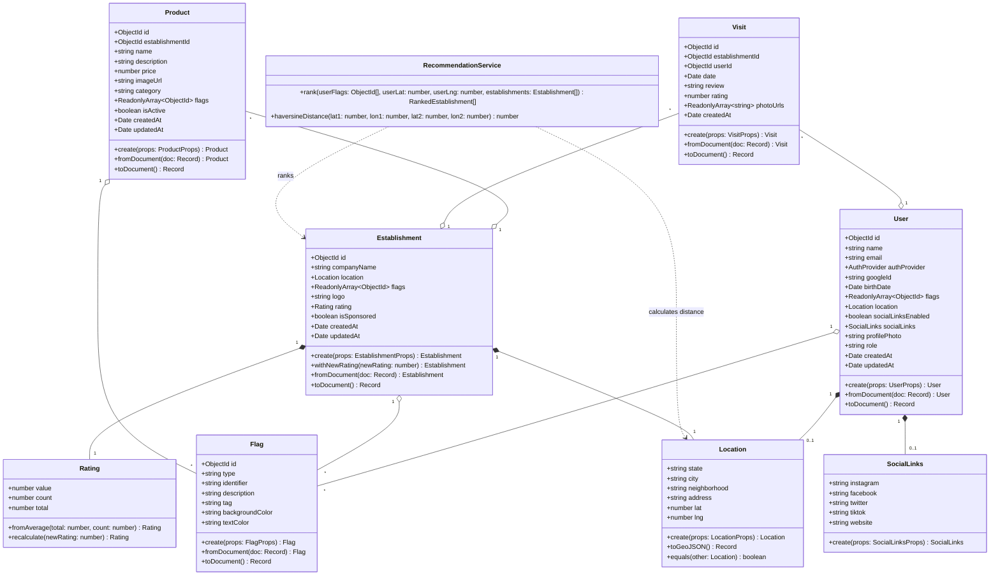
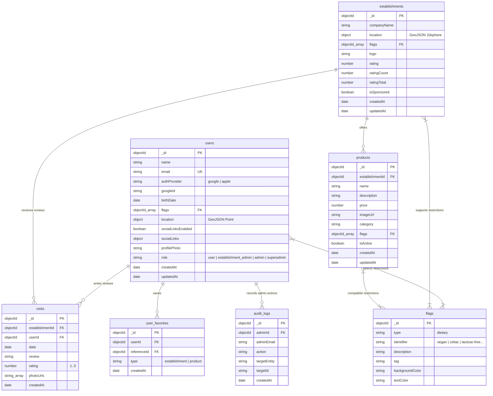
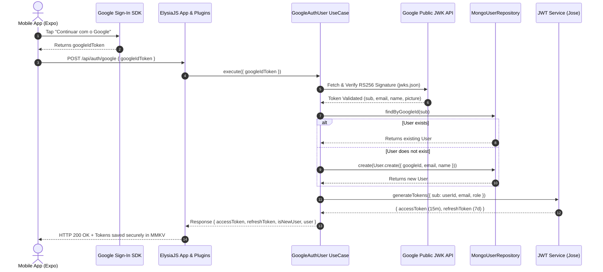
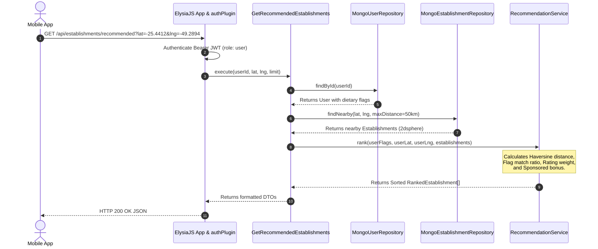

# HelpRest Backend — Architecture & Patterns

## Overview

The HelpRest API is a RESTful backend built with **Bun** runtime, **ElysiaJS**, **MongoDB** (official driver, no ODM), and **Redis** for caching/rate-limiting. It follows **Clean Architecture** with **Domain-Driven Design (DDD)** organization.

**Entry point:** `src/index.ts` (creates Elysia app from `src/app.ts`)  
**Dev command:** `bun run dev` (auto-restarts on changes via `--hot`)  
**Seed command:** `bun run seed` (populates database with test data)  
**Test command:** `bun test` (`bun run test:unit` for isolated unit tests)  
**OpenAPI / Swagger UI:** `GET /swagger`  
**API test file:** `resources/api/api.http` (VS Code REST Client)  
**Insomnia collection:** `resources/api/insomnia.json`

---

## Architecture Layers

```
src/
├── app.ts           → ElysiaJS application wiring Swagger, plugins & modules
├── domain/          → Business rules (zero external dependencies)
├── application/     → Use cases / orchestration
├── infrastructure/  → Database, cache, security implementations
├── interface/       → ElysiaJS modules, plugins, TypeBox & Zod validation
└── shared/          → Errors, utilities, types
```

**Dependency Rule:** Dependencies always point inward → `interface → application → domain`. Never the reverse. Infrastructure implements domain contracts.

---

## Domain Layer (`src/domain/`)

### Entities

| Entity | File | Key Fields |
|---|---|---|
| `User` | `entities/User.ts` | name, email, authProvider (`google` \| `apple`), googleId?, birthDate?, flags (`ObjectId[]`), location, socialLinks, profilePhoto, role (`Role`), status (`active` \| `suspended` \| `banned`), isBanned, banReason, bannedAt |
| `Establishment` | `entities/Establishment.ts` | companyName, location (GeoJSON), flags, logo, rating, ratingCount, isSponsored, adminId? |
| `Product` | `entities/Product.ts` | establishmentId, category, name, description, price, ingredients, flags, imageUrl, isActive |
| `Flag` | `entities/Flag.ts` | type, identifier, description, tag, backgroundColor, textColor, isActive, order |
| `Visit` | `entities/Visit.ts` | establishmentId, userId, date, review, rating (1-5), photoUrls, isReported, reportCount, reports, isModerated, moderatedReason |
| `UserFavorite` | `entities/UserFavorite.ts` | userId, referenceId, type (`establishment` \| `product`), createdAt |
| `AuditLog` | `entities/AuditLog.ts` | adminId, adminEmail, action, targetEntity, targetId, details, ipAddress?, createdAt |

All entities:
- Are created via static `create()` factory with validation
- Serialized/deserialized via `toDocument()` / `fromDocument()` for MongoDB
- Immutable after creation (use `withNewRating()`, `withRole()`, `withBan()`, `withUpdatedProps()` pattern for updates)

### Value Objects (`value-objects/`)

- **`Location`** — state, city, neighborhood, address, coordinates. Has `toGeoJSON()` for MongoDB 2dsphere queries.
- **`SocialLinks`** — instagram, facebook, twitter, tiktok, website.
- **`Rating`** — 0-5 with `fromAverage(total, count)` factory and `recalculate(newRating)`.
- **`Role`** — hierarchical RBAC levels (`user` < `establishment_admin` < `admin` < `superadmin`, mapping legacy `"establishment"` to `"establishment_admin"`).

### Repository Interfaces (`repositories/`)

Abstract contracts implemented by infrastructure layer:
- `IUserRepository` — CRUD + `findByEmail()`, `findByGoogleId()`, `findAll()`, `count()`, `getFlagDistribution()`
- `IEstablishmentRepository` — CRUD + `findNearby()` (geospatial) + `findByFlags()` + `search()` (text) + `findSponsored()` + `findByAdminId()` + `count()`
- `ProductRepository` (`application/repositories/`) — `findById()`, `findByEstablishmentId()`, `save()`, `update()`, `delete()`
- `IFlagRepository` — CRUD + `findAll(includeInactive?)`, `findByIds()`, `findByType()`, `updateOrder()`
- `IVisitRepository` — CRUD + `findByUserId()`, `findByEstablishmentId()`, `findRecentForSocialFeed()`, `findReported()`, `count()`
- `IUserFavoriteRepository` — `add()`, `remove()`, `findByUserId()`, `exists()`
- `IAuditLogRepository` — `create()`, `findAll()`

### Domain Services (`services/`)

**`RecommendationService`** — Core recommendation algorithm:
- With active user dietary flags: Score = `flagMatchRatio * 0.7 + proximityScore * 0.2 + (rating / 5) * 0.1 + (isSponsored ? 0.05 : 0)`
- Without user dietary flags: Score = `proximityScore * 0.7 + (rating / 5) * 0.3 + (isSponsored ? 0.05 : 0)`
- Excludes zero-match establishments (`score = 0`, ignoring `sponsorBonus`) when the user has active dietary flags
- Uses Haversine formula for distance calculation
- Stateless, pure logic, no external dependencies

---

## Application Layer (`src/application/`)

### Use Cases

| Module | Use Cases |
|---|---|
| `auth/` | `GoogleAuthUser`, `RefreshToken` |
| `user/` | `GetUserProfile`, `UpdateUserProfile`, `UpdateUserFlags` |
| `establishment/` | `ListEstablishments`, `GetEstablishment`, `GetRecommendedEstablishments`, `GetNearbyEstablishments`, `SearchEstablishments`, `CreateEstablishment`, `GetEstablishmentByAdmin` |
| `product/` | `CreateProduct`, `UpdateProduct`, `DeleteProduct` |
| `flag/` | `ListFlags`, `CreateFlag`, `UpdateFlag`, `DeleteFlag`, `ReorderFlags` |
| `visit/` | `CreateVisit` (auto-recalculates rating + 100m photo geofencing), `ListUserVisits`, `GetEstablishmentVisits`, `GetSocialFeed`, `ReportVisit` |
| `favorite/` | `AddFavorite`, `RemoveFavorite`, `GetUserFavorites` |
| `admin/` | `GetAdminDashboardMetrics`, `ListUsers`, `UpdateUserRole`, `BanUser`, `GetUserHistory`, `ListReportedVisits`, `ModerateVisit`, `ListAuditLogs` |

Each use case:
- Receives validated input (from Elysia TypeBox / Zod schemas)
- Returns DTOs (never exposes raw MongoDB documents)
- Takes repository interfaces via constructor injection

---

## Infrastructure Layer (`src/infrastructure/`)

### MongoDB (`database/mongodb/`)

- **`connection.ts`** — Singleton MongoClient with connection pooling (max 10, min 2)
- **`collections.ts`** — Collection name constants (`users`, `establishments`, `flags`, `visits`, `products`, `user_favorites`, `audit_logs`) + typed accessor functions
- **`indexes.ts`** — Creates indexes on startup:
  - `2dsphere` on `establishments.location.coordinates` (geospatial)
  - `text` on `establishments.companyName` (search)
  - `unique` on `users.email`
  - Compound indexes for visits and sponsored sort

### Redis (`database/redis/`)

- Lazy-connected singleton (`ioredis`)
- Won't crash the app if unavailable (graceful degradation)

### Repositories (`repositories/`)

MongoDB implementations of domain contracts:
- `MongoUserRepository`, `MongoEstablishmentRepository`, `MongoProductRepository`, `MongoFlagRepository`, `MongoVisitRepository`, `MongoUserFavoriteRepository`, `MongoAuditLogRepository`
- Establishment repo uses `$geoNear` aggregation pipeline for proximity queries
- All use `fromDocument()` / `toDocument()` for entity mapping

### Security (`security/`)

- **`jwt.ts`** — Access tokens (15min) + refresh tokens (7d), rotated (`role` claim embedded). Uses `jose` library with HS256; Google ID token verification via `jose.createRemoteJWKSet`.
- **`rateLimiter.ts`** — Sliding window via Redis sorted sets. Configs: AUTH (10/min), API (100/min), SEARCH (30/min).

### Cache (`cache/`)

- **`RedisCacheService`** — Generic get/set/delete with TTL and prefix-based invalidation.

---

## Interface Layer (`src/interface/`)

### ElysiaJS App & Plugins (`src/app.ts`, `src/interface/plugins/`)

Replaces the legacy `Bun.serve` regex router (`src/interface/http/router.ts`, kept deprecated/unused):

| Plugin | Purpose |
|---|---|
| `securityPlugin` | Applies CORS, runs recursive `sanitize()` on `body` and `query` against NoSQL operators (`$gt`, `$ne`, etc.), attaches OWASP security headers |
| `errorPlugin` | Maps `AppError` subclasses, `ValidationError` details, Elysia `VALIDATION` (`400`), `NOT_FOUND` (`404`), and unexpected `500` errors to JSON envelopes |
| `authPlugin` | Integrates `@elysiajs/bearer` + `@elysiajs/jwt` and provides the declarative `{ role }` macro checked via `Role.hasPermission()` |

### Feature Modules (`src/interface/modules/`)

- `auth.module.ts`, `user.module.ts`, `establishment.module.ts`, `product.module.ts`, `flag.module.ts`, `visit.module.ts`, `favorite.module.ts`, `admin.module.ts`
- Each exports a `create*Module(...)` factory with optional repository injection for isolated unit tests and Swagger OpenAPI tags (`/swagger`).

---

## API Endpoints

### Auth (public — OAuth-Only)
| Method | Route | Description |
|---|---|---|
| `POST` | `/api/auth/google` | Google OAuth2 login (verify ID token, find-or-create user) |
| `POST` | `/api/auth/refresh` | Rotate refresh token |

### Users (authenticated — `role: "user"`)
| Method | Route | Description |
|---|---|---|
| `GET` | `/api/users/me` | Current user profile |
| `PATCH` | `/api/users/me` | Update profile |
| `PATCH` | `/api/users/me/flags` | Update dietary flags |

### Establishments (`role: "user"` / `role: "establishment_admin"`)
| Method | Route | Description |
|---|---|---|
| `GET` | `/api/establishments` | Paginated list |
| `GET` | `/api/establishments/recommended` | Flag-ranked recommendations |
| `GET` | `/api/establishments/nearby` | Geospatial proximity |
| `GET` | `/api/establishments/search` | Text search |
| `GET` | `/api/establishments/my-establishment` | Managed establishment (`establishment_admin`) |
| `GET` | `/api/establishments/:id` | Detail (includes products) |
| `POST` | `/api/establishments` | Create (`establishment_admin`) |

### Products (`role: "establishment_admin"`)
| Method | Route | Description |
|---|---|---|
| `POST` | `/api/products` | Create product in establishment menu |
| `PATCH` | `/api/products/:id` | Update product or toggle active status |
| `DELETE` | `/api/products/:id` | Delete product |

### Flags (public GET / `role: "admin"` writes)
| Method | Route | Description |
|---|---|---|
| `GET` | `/api/flags` | List active dietary & accessibility flags |
| `GET` | `/api/flags/admin/all` | List all flags including inactive (`admin`) |
| `POST` | `/api/flags` | Create flag (`admin`) |
| `PATCH` | `/api/flags/reorder` | Batch reorder flags (`admin`) |
| `PATCH` | `/api/flags/:id` | Update flag (`admin`) |
| `DELETE` | `/api/flags/:id` | Delete flag (`admin`) |

### Visits & Social (`role: "user"`)
| Method | Route | Description |
|---|---|---|
| `POST` | `/api/visits` | Create visit/review (100m geofencing when sending photos) |
| `POST` | `/api/visits/:id/report` | Report offensive or inappropriate review |
| `GET` | `/api/visits/user/:userId` | User's visit history |
| `GET` | `/api/visits/establishment/:id` | Establishment reviews |
| `GET` | `/api/social/feed` | Geolocation-aware social activity feed |

### Favorites (`role: "user"`)
| Method | Route | Description |
|---|---|---|
| `GET` | `/api/favorites` | List favorited establishments and products |
| `POST` | `/api/favorites` | Add establishment or product to favorites |
| `DELETE` | `/api/favorites/:id` | Remove from favorites |

### Admin (`role: "admin"`)
| Method | Route | Description |
|---|---|---|
| `GET` | `/api/admin/dashboard` | Global dashboard metrics & analytics |
| `GET` | `/api/admin/visits/reported` | List reported visits for moderation |
| `PATCH` | `/api/admin/visits/:id/moderate` | Hide or unhide reported visit (writes `AuditLog`) |
| `GET` | `/api/admin/users` | Search/filter paginated users |
| `PATCH` | `/api/admin/users/:id/role` | Update user role (writes `AuditLog`) |
| `PATCH` | `/api/admin/users/:id/ban` | Ban/unban user (writes `AuditLog`) |
| `GET` | `/api/admin/users/:id/history` | Full user profile, visits, favorites history |
| `GET` | `/api/admin/audit-logs` | Paginated admin action audit logs |

### System & Docs
| Method | Route | Description |
|---|---|---|
| `GET` | `/api/health` | Health check |
| `GET` | `/swagger` | OpenAPI / Swagger UI documentation |

---

## Testing Endpoints (`api.http`)

O arquivo `resources/api/api.http` é o **padrão** para documentar e testar endpoints. Usa a extensão [REST Client](https://marketplace.visualstudio.com/items?itemName=humao.rest-client) do VS Code. Para Insomnia, importe `resources/api/insomnia.json`.

**Regras:**
- Todo novo endpoint **deve** ser adicionado ao `api.http` com um example request.
- O login request via Google OAuth pode preencher `{{accessToken}}` para requests autenticados.
- Agrupe requests por seção (AUTH, USER, ESTABLISHMENTS, PRODUCTS, FLAGS, VISITS, FAVORITES, ADMIN).
- Inclua body de exemplo para POST/PATCH.
- Para Insomnia/Bruno: importe o `api.http` diretamente.

---

## Environment Variables

All defined in `.env` (gitignored) with `.env.example` for reference:

| Variable | Purpose |
|---|---|
| `PORT` | Server port (default: 3000) |
| `NODE_ENV` | development / production / test |
| `MONGODB_URI` | MongoDB Atlas connection string |
| `REDIS_URL` | Redis connection URL |
| `JWT_SECRET` | HMAC secret for access tokens |
| `JWT_REFRESH_SECRET` | HMAC secret for refresh tokens |
| `JWT_ACCESS_EXPIRATION` | Access token TTL (default: 15m) |
| `JWT_REFRESH_EXPIRATION` | Refresh token TTL (default: 7d) |
| `CORS_ORIGINS` | Comma-separated allowed origins (default: *) |
| `GOOGLE_OAUTH_CLIENT_ID` | Google OAuth2 client ID for ID token verification |

---

## Shared Utilities (`src/shared/`)

### Error Hierarchy (`errors/`)

All extend `AppError`:
- `NotFoundError` (404)
- `UnauthorizedError` (401)
- `ForbiddenError` (403)
- `ValidationError` (400) — includes field-level error details
- `ConflictError` (409)
- `RateLimitError` (429)

### Utils
- **`sanitize.ts`** — Strips MongoDB query operators (`$gt`, `$ne`, etc.) to prevent NoSQL injection
- **`logger.ts`** — Structured JSON logger with request ID correlation

---

## Path Aliases

Configured in `tsconfig.json`:

| Alias | Target |
|---|---|
| `@domain/*` | `src/domain/*` |
| `@application/*` | `src/application/*` |
| `@infra/*` | `src/infrastructure/*` |
| `@interface/*` | `src/interface/*` |
| `@shared/*` | `src/shared/*` |

---

## Testing

- **Runner:** Bun Test Runner (configured in `bunfig.toml`)
- **Setup:** `tests/setup.ts` — sets isolated env vars
- **Unit tests:** `tests/unit/` — domain entities, value objects, `RecommendationService`, admin use cases, Elysia modules/plugins, `sanitize` (`bun run test:unit`)
- **Integration tests:** `tests/integration/` — geofencing and product catalog flows

---

## Running Locally

```bash
cd helprest-api
cp .env.example .env      # Configure your MongoDB URI
bun install
bun run dev               # Starts with --hot
```

## Key Design Decisions

1. **No ODM (Mongoose)** — Uses official MongoDB driver for performance and control
2. **Jose + `@elysiajs/jwt`** — Modern ESM-native JWT signing/verification with HS256
3. **ElysiaJS + TypeBox / Zod v4** — Modular route plugins, OpenAPI (`/swagger`), declarative RBAC (`{ role }`), and typed schema validation
4. **OAuth-Only Authentication** — Centralized via Google OAuth ID Token verification server-side using `jose.createRemoteJWKSet`, eliminating local password storage/hashing overhead and reducing attack surface
5. **Module Factories with Singleton Repositories** — `create*Module(...)` instantiates Mongo repositories once while permitting mock injection in unit tests
6. **Use cases per-request** — Created fresh per handler call for isolation
7. **Immutable entities** — Updates return new instances (`withNewRating()`, `withRole()`, `withBan()`)
8. **Google OAuth server-side** — Uses `jose.createRemoteJWKSet` to verify Google ID tokens with Google's public JWK set; no Google SDK required on backend

---

## Visual Architecture Diagrams (Mermaid)

### Domain Class Diagram (Entities, Value Objects & Domain Services)



### NoSQL DER Diagram (MongoDB Collections & Relationships)



### Data Flow & Sequence Diagrams

#### 1. Google OAuth Authentication Flow



#### 2. Recommendation & Proximity Algorithm Flow



